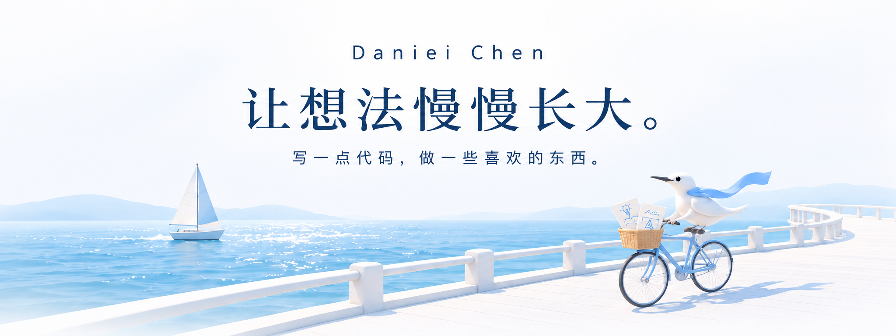
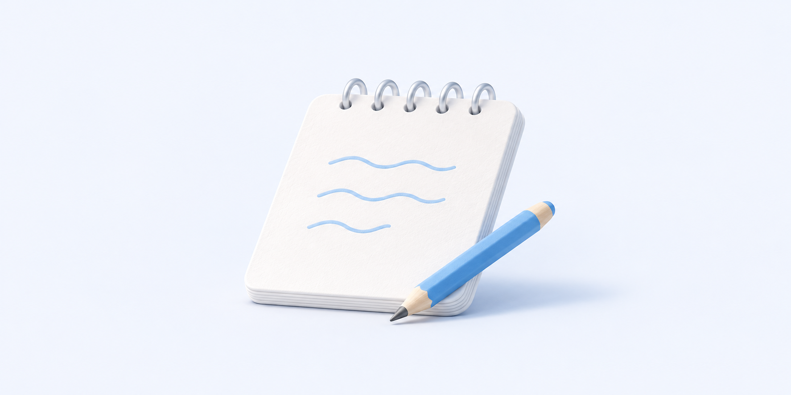

<!-- Generated by tools/make_readme.py. Edit the generator, not this file. -->

<picture>
  <source media="(max-width: 640px)" srcset="assets/coastal/coastal-hero-mobile.png">
  
</picture>

独立开发者。做一些有用的东西，也给创造留一点快乐。

[看看作品](#最近在做) · [全部仓库](https://github.com/daniei-chen?tab=repositories)

## 最近在做

<table>
  <tr>
    <td width="33%" valign="top">
      
      
<strong><a href="https://github.com/daniei-chen/ZCode-App">ZCode-App</a></strong>

      
手机远程任务。

    </td>
    <td width="33%" valign="top">
      
      
<strong><a href="https://github.com/daniei-chen/Little-Whale">小鲸鱼</a></strong>

      
本地媒体解析。

    </td>
    <td width="33%" valign="top">
      
      
<strong><a href="https://github.com/daniei-chen/dsh-token-insight">DSH Token Insight</a></strong>

      
本地用量统计。

    </td>
  </tr>
</table>

## 也在探索

- [**智汇 · zhihui-gateway**](https://github.com/daniei-chen/zhihui-gateway) — WorkBuddy、Qoder、Trae 的统一工作台。
- [**智境 · zhijing-gateway**](https://github.com/daniei-chen/zhijing-gateway) — AI 网关的登录、成员与管理前端。

用 Flutter / Dart 做移动应用，也写 Go、Python 和 TypeScript。喜欢把一个想法从原型慢慢打磨成作品。

有建议、遇到问题，欢迎到对应仓库的 Issues 聊聊。

  
更多仓库与小实验

  <ul>
    <li><a href="https://github.com/daniei-chen/hongguo-duanju">hongguo-duanju</a> · 筹备中</li>
  </ul>

