

<picture>
  <source media="(prefers-color-scheme: dark)" srcset="assets/banner-dark.svg">
  <source media="(prefers-color-scheme: light)" srcset="assets/banner-light.svg">
  
</picture>

<picture>
  <source media="(prefers-color-scheme: dark)" srcset="assets/typing-dark.svg">
  <source media="(prefers-color-scheme: light)" srcset="assets/typing-light.svg">
  
</picture>

 

<picture>
  <source media="(prefers-color-scheme: dark)" srcset="assets/divider-dark.svg">
  <source media="(prefers-color-scheme: light)" srcset="assets/divider-light.svg">
  
</picture>

<picture>
  <source media="(prefers-color-scheme: dark)" srcset="assets/hdr-about-dark.svg">
  <source media="(prefers-color-scheme: light)" srcset="assets/hdr-about-light.svg">
  
</picture>

- 🛠 **独立开发者** —— 习惯一个人把一个想法从原型推到能上线的产品
- 📱 主力技术栈 **Flutter / Dart**，以 Android 端为主，必要时下沉到原生；服务端写 **Go / Python**
- 🧩 最近在做 **DSH 插件与本地优先的 AI 工具**：使用统计、安卓远控、模型网关
- 🔒 相信工具该在**本地**解决问题：小鲸鱼的解析全程跑在手机上，链接不经过任何第三方服务器
- 🧪 喜欢把踩过的坑沉淀成能复用的方案，而不是一次性脚本
- 🚀 信奉「**先做出来，再做好**」
- 📫 交流走 Issue 就行，每个仓库都开着

<picture>
  <source media="(prefers-color-scheme: dark)" srcset="assets/terminal-dark.svg">
  <source media="(prefers-color-scheme: light)" srcset="assets/terminal-light.svg">
  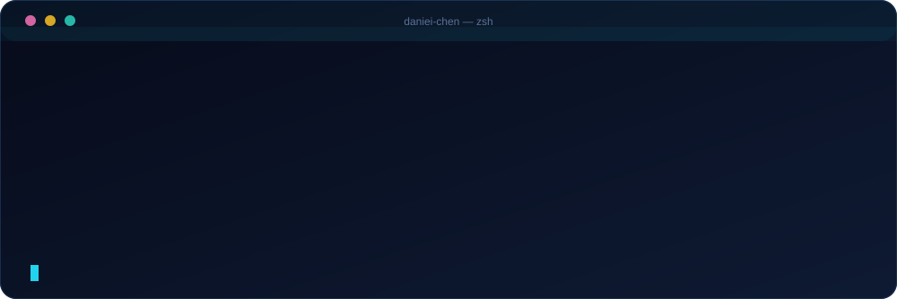
</picture>
<picture>
  <source media="(prefers-color-scheme: dark)" srcset="assets/hdr-dsh-dark.svg">
  <source media="(prefers-color-scheme: light)" srcset="assets/hdr-dsh-light.svg">
  
</picture>

<picture>
  <source media="(prefers-color-scheme: dark)" srcset="assets/dsh-dark.svg">
  <source media="(prefers-color-scheme: light)" srcset="assets/dsh-light.svg">
  
</picture>

> 统计、远控、插件、中继——都围绕同一个本地 DSH host；数据不离开自己的机器。

<picture>
  <source media="(prefers-color-scheme: dark)" srcset="assets/hdr-stack-dark.svg">
  <source media="(prefers-color-scheme: light)" srcset="assets/hdr-stack-light.svg">
  
</picture>

<picture>
  <source media="(prefers-color-scheme: dark)" srcset="assets/lang-dark.svg">
  <source media="(prefers-color-scheme: light)" srcset="assets/lang-light.svg">
  
</picture>

<table>
<tr>

<td valign="top" width="50%">

**框架与运行时**

</td>

<td valign="top" width="50%">

**服务端与工程**

</td>

</tr>
</table>
<picture>
  <source media="(prefers-color-scheme: dark)" srcset="assets/hdr-projects-dark.svg">
  <source media="(prefers-color-scheme: light)" srcset="assets/hdr-projects-light.svg">
  
</picture>

  <a href="https://github.com/daniei-chen/dsh-token-insight" title="DSH Token Insight — DSH 本地使用统计：52 周热力图、每日趋势、模型用量、会话 Top 5、成本与导出，全程只读本地文件。">
    <picture>
      <source media="(prefers-color-scheme: dark)" srcset="assets/proj-dshtokeninsight-dark.svg">
      <source media="(prefers-color-scheme: light)" srcset="assets/proj-dshtokeninsight-light.svg">
      
    </picture>
  </a>

  <a href="https://github.com/daniei-chen/DeepSeek-Harness-APP" title="DeepSeek Harness APP — 自托管 DSH 的安卓客户端：WebView UI、扫码/Relay 配对、审批通知、文件上传与多设备管理。">
    <picture>
      <source media="(prefers-color-scheme: dark)" srcset="assets/proj-deepseekharnessapp-dark.svg">
      <source media="(prefers-color-scheme: light)" srcset="assets/proj-deepseekharnessapp-light.svg">
      
    </picture>
  </a>

  <a href="https://github.com/daniei-chen/ZCode-App" title="ZCode-App — 在手机或平板上远程管理 ZCode 桌面任务。扫码接入，原生 Flutter 外壳 + WebView 会话。">
    <picture>
      <source media="(prefers-color-scheme: dark)" srcset="assets/proj-zcodeapp-dark.svg">
      <source media="(prefers-color-scheme: light)" srcset="assets/proj-zcodeapp-light.svg">
      
    </picture>
  </a>

  <a href="https://github.com/daniei-chen/WorkBuddy-API" title="WorkBuddy2API — 自托管的 OpenAI 兼容网关：把 CodeBuddy 账号包装成统一的 /v1/chat/completions 服务，多账号池轮转 + 会话粘性 + 额度治理。">
    <picture>
      <source media="(prefers-color-scheme: dark)" srcset="assets/proj-workbuddyapi-dark.svg">
      <source media="(prefers-color-scheme: light)" srcset="assets/proj-workbuddyapi-light.svg">
      
    </picture>
  </a>

  <a href="https://github.com/daniei-chen/Little-Whale" title="小鲸鱼 — 粘贴链接，保存无水印原片。解析全程在手机本地完成，链接不上传、不经过任何服务器。">
    <picture>
      <source media="(prefers-color-scheme: dark)" srcset="assets/proj-littlewhale-dark.svg">
      <source media="(prefers-color-scheme: light)" srcset="assets/proj-littlewhale-light.svg">
      
    </picture>
  </a>

  <a href="https://github.com/daniei-chen/solar-system" title="太阳系 · 3D 仿真 — 单文件、离线可用的真渲染太阳系仿真：真实星历与 25,791 颗恒星，从日面一路退到 30 kpc 回望银河系。">
    <picture>
      <source media="(prefers-color-scheme: dark)" srcset="assets/proj-solarsystem-dark.svg">
      <source media="(prefers-color-scheme: light)" srcset="assets/proj-solarsystem-light.svg">
      
    </picture>
  </a>

  <a href="https://github.com/daniei-chen/Forbidden-City" title="紫禁城 · 3D 复原 — 单文件 Three.js 可漫游的紫禁城程序化场景：七殿室内、四时段、SSAO、NPC 与跳跃，零外部资源。">
    <picture>
      <source media="(prefers-color-scheme: dark)" srcset="assets/proj-forbiddencity-dark.svg">
      <source media="(prefers-color-scheme: light)" srcset="assets/proj-forbiddencity-light.svg">
      
    </picture>
  </a>

  <a href="https://github.com/daniei-chen/zhihui-gateway" title="zhihui-gateway — 面向 WorkBuddy、Qoder 和 Trae等多平台 的 AI 网关与管理平台，提供统一入口、平台路由、API 密钥管理、用量统计与运行监控。">
    <picture>
      <source media="(prefers-color-scheme: dark)" srcset="assets/proj-zhihuigateway-dark.svg">
      <source media="(prefers-color-scheme: light)" srcset="assets/proj-zhihuigateway-light.svg">
      
    </picture>
  </a>

<picture>
  <source media="(prefers-color-scheme: dark)" srcset="assets/hdr-repos-dark.svg">
  <source media="(prefers-color-scheme: light)" srcset="assets/hdr-repos-light.svg">
  
</picture>

> 上面是当前主项目；这里是全部公开仓库，按方向分组，Fork 和空仓库也保留入口。

### DSH / AI 工具

| 仓库 | 语言 | ★ | 最近更新 | 说明 |
| --- | --- | ---: | --- | --- |
| [DSH Token Insight](https://github.com/daniei-chen/dsh-token-insight) | `JavaScript` | 1 | 2026-10-23 | DSH 本地使用统计：52 周热力图、每日趋势、模型用量、会话 Top 5、成本与导出，全程只读本地文件。 |
| [DeepSeek Harness APP](https://github.com/daniei-chen/DeepSeek-Harness-APP) | `Kotlin` | 1 | 2026-10-27 | 自托管 DSH 的安卓客户端：WebView UI、扫码/Relay 配对、审批通知、文件上传与多设备管理。 |
| [WorkBuddy2API](https://github.com/daniei-chen/WorkBuddy-API) | `Python` | 4 | 2026-10-26 | 自托管的 OpenAI 兼容网关：把 CodeBuddy 账号包装成统一的 /v1/chat/completion… |
| [DSH 破甲](https://github.com/daniei-chen/dsh-purge) · fork | `-` | 0 | 2026-10-19 | DSH 提示词实验：不同模型可换不同提示词，默认面向国模小码酱。 |

### 移动端 / Flutter

| 仓库 | 语言 | ★ | 最近更新 | 说明 |
| --- | --- | ---: | --- | --- |
| [ZCode-App](https://github.com/daniei-chen/ZCode-App) | `Dart` | 5 | 2026-10-26 | 在手机或平板上远程管理 ZCode 桌面任务。扫码接入，原生 Flutter 外壳 + WebView 会话。 |
| [小鲸鱼](https://github.com/daniei-chen/Little-Whale) | `Dart` | 4 | 2026-10-25 | 粘贴链接，保存无水印原片。解析全程在手机本地完成，链接不上传、不经过任何服务器。 |

### 3D / 视觉实验

| 仓库 | 语言 | ★ | 最近更新 | 说明 |
| --- | --- | ---: | --- | --- |
| [紫禁城 · 3D 复原](https://github.com/daniei-chen/Forbidden-City) | `JavaScript` | 1 | 2026-10-21 | 单文件 Three.js 可漫游的紫禁城程序化场景：七殿室内、四时段、SSAO、NPC 与跳跃，零外部资源。 |
| [太阳系 · 3D 仿真](https://github.com/daniei-chen/solar-system) | `HTML` | 2 | 2026-10-07 | 单文件、离线可用的真渲染太阳系仿真：真实星历与 25,791 颗恒星，从日面一路退到 30 kpc 回望银河系。 |

### 工具 / 其他

| 仓库 | 语言 | ★ | 最近更新 | 说明 |
| --- | --- | ---: | --- | --- |
| [QQ 空间备份](https://github.com/daniei-chen/QQ-Space-Nostalgia) | `-` | 1 | 2026-09-27 | 按年份、月份或动态编号归档本人 QQ 空间图片，找回那些年的青春回忆。 · 空仓库 |

### Fork / 实验

| 仓库 | 语言 | ★ | 最近更新 | 说明 |
| --- | --- | ---: | --- | --- |
| [DeepSeek Harness](https://github.com/daniei-chen/deepseek-harness) · fork | `TypeScript` | 0 | 2026-10-04 | DeepSeek Harness 上游仓库的 Fork，用于跟进插件系统与运行时变化。 |

### 其他

| 仓库 | 语言 | ★ | 最近更新 | 说明 |
| --- | --- | ---: | --- | --- |
| [zhihui-gateway](https://github.com/daniei-chen/zhihui-gateway) | `Python` | 0 | 2026-10-27 | 面向 WorkBuddy、Qoder 和 Trae等多平台 的 AI 网关与管理平台，提供统一入口、平台路由、AP… |

<picture>
  <source media="(prefers-color-scheme: dark)" srcset="assets/hdr-stats-dark.svg">
  <source media="(prefers-color-scheme: light)" srcset="assets/hdr-stats-light.svg">
  
</picture>

<picture>
  <source media="(prefers-color-scheme: dark)" srcset="assets/stats-dark.svg">
  <source media="(prefers-color-scheme: light)" srcset="assets/stats-light.svg">
  
</picture>

<picture>
  <source media="(prefers-color-scheme: dark)" srcset="assets/activity-dark.svg">
  <source media="(prefers-color-scheme: light)" srcset="assets/activity-light.svg">
  
</picture>

> 上面的图**不是第三方图床的静态卡片**：数据由本仓库的 GitHub Action 每天重新抓取并重绘（最近更新 `2026-10-27`），
> 素材全部自绘，深浅色模式各一套。
<picture>
  <source media="(prefers-color-scheme: dark)" srcset="assets/hdr-focus-dark.svg">
  <source media="(prefers-color-scheme: light)" srcset="assets/hdr-focus-light.svg">
  
</picture>

<picture>
  <source media="(prefers-color-scheme: dark)" srcset="assets/focus-dark.svg">
  <source media="(prefers-color-scheme: light)" srcset="assets/focus-light.svg">
  
</picture>

> 占比是自评，不是考试成绩，会随手上在做的东西变。
<picture>
  <source media="(prefers-color-scheme: dark)" srcset="assets/divider-dark.svg">
  <source media="(prefers-color-scheme: light)" srcset="assets/divider-light.svg">
  
</picture>

**如果哪个仓库对你有用，点个 ⭐ 就是最好的鼓励。**

