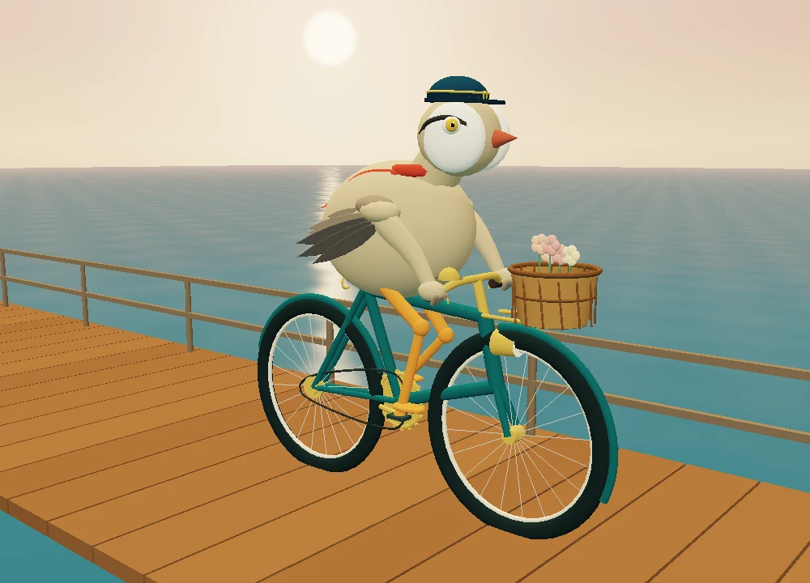

<!-- Generated by tools/make_readme.py. Edit the generator, not this file. -->

<picture>
  <source media="(max-width: 640px)" srcset="assets/coastal/coastal-hero-mobile.webp">
  
</picture>

独立开发者。做一些有用的东西，也给创造留一点快乐。

<a href="#user-content-智汇">智汇</a> · <a href="#user-content-智境">智境</a> · <a href="#user-content-一些小作品">小作品</a> · <a href="#user-content-一点关于我">关于我</a>

 

最近在做 · 两个持续打磨的项目

## [智汇](https://github.com/daniei-chen/zhihui-gateway)

### 让灵感出发，让工作向前。

WorkBuddy、Qoder、Trae 的统一工作台。

[访问网站](https://zhihui.kaogong.art/) · [查看项目](https://github.com/daniei-chen/zhihui-gateway)

 

## [智境](https://github.com/daniei-chen/zhijing-gateway)

### 复杂有序，智能从容。

AI 网关的登录、成员与管理前端。

[界面一览](https://github.com/daniei-chen/zhijing-gateway#界面一览) · [查看项目](https://github.com/daniei-chen/zhijing-gateway)

 

## 一些小作品

从远程任务，到日常记录。为遇到的小需求，做一些顺手的东西。

### [ZCode App](https://github.com/daniei-chen/ZCode-App)

扫码连接 ZCode，把桌面任务与会话带到手机上。

[了解项目](https://github.com/daniei-chen/ZCode-App) · [下载版本](https://github.com/daniei-chen/ZCode-App/releases)

 

### [小鲸鱼](https://github.com/daniei-chen/Little-Whale)

本地解析与下载视频，把喜欢的片段留在身边。

[了解项目](https://github.com/daniei-chen/Little-Whale) · [下载版本](https://github.com/daniei-chen/Little-Whale/releases)

 

### [DSH Token Insight](https://github.com/daniei-chen/dsh-token-insight)

从 Token 到会话趋势，记录 DSH 的本地使用。

[了解项目](https://github.com/daniei-chen/dsh-token-insight) · [下载版本](https://github.com/daniei-chen/dsh-token-insight/releases)

 

## 一点关于我

用 Flutter / Dart 做移动应用，也写 Go、Python 和 TypeScript。喜欢把原型慢慢打磨成作品，让功能与细节一起变好。

喜欢海风、日光，和有呼吸感的界面。欢迎到对应项目的 Issues，聊聊你的想法。

[浏览全部仓库](https://github.com/daniei-chen?tab=repositories) · [回到页首](#user-content-daniei-chen)

---

谢谢你来这里。愿你的想法，也慢慢长大。

海岸骑行场景来自智汇网站 · 改编自 <a href="https://github.com/JacoryOu/pelican-velo">Jacory Ou / Pelican · Velo</a> · <a href="assets/coastal/PELICAN-VELO-LICENSE.txt">MIT</a>

